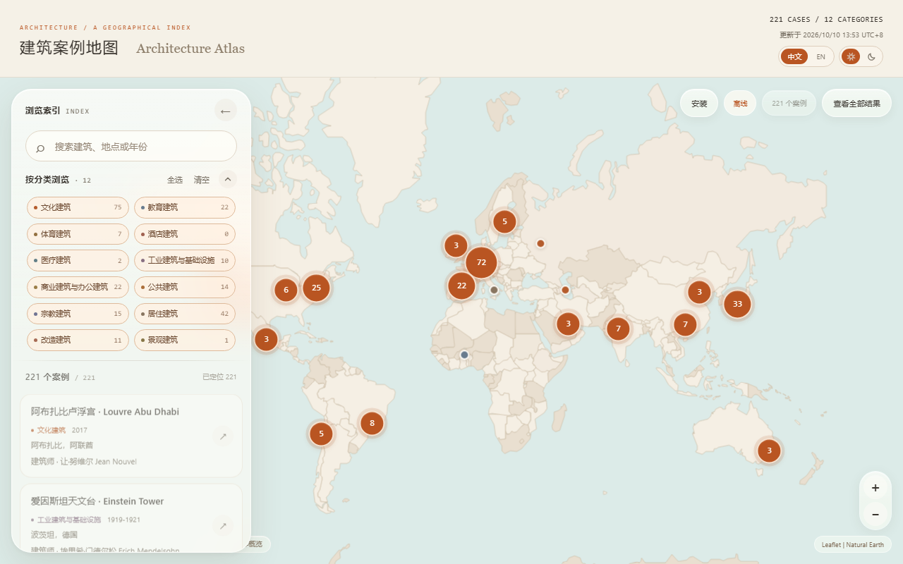

# ArchCase · Architecture Precedent Collection

[简体中文](README.md) · [繁體中文](README.zh-TW.md) · English

This collection of classic and personally favorite buildings grew out of my early undergraduate studies. It aims to help students beginning university architecture studies, as well as anyone interested in architecture, discover, read about, and organize architectural precedents.

**Choose the material first, then how to access it:** building cases, architect references, and T100 are the collection's contents. Markdown (MD) documents and the interactive map are the reading entry points; HTML, PWA, and APK are different forms of the map.

The HTML download and Android installation guides are also available in English. Other detailed guides and the original study notes retain their existing languages.

## 1. Collection contents and reading entry points

| Material | Contents | Start here |
| --- | --- | --- |
| Building cases | 221 works organized into 12 categories | [Browse by building type](notes/00%20Cases/README.md) |
| Architects and practices | 83 entries, plus a Pritzker Prize index | [Architect index](notes/01%20Architect/README.md) |
| T100 personal selection | Mainly significant twentieth-century works, with a small number of twenty-first-century projects | [T100 reading index](notes/T100.md) |
| All MD documents | 305 original notes to download, read, and continue organizing | [Document directory and import guide](notes/README.md) |

**What is T100?** It is a personal selection of architectural works. The original aim was to choose **approximately 100 works that I considered important to twentieth-century architecture**, while also including a small number of twenty-first-century projects. It is a reading trail shaped by personal judgment and open to further revision. This snapshot contains **101 case notes tagged T100**; the tag keeps the name of the original selection concept.

The categories cover cultural, educational, sports, hotel, healthcare, industrial and infrastructure, commercial and office, public, religious, residential, renovation, and landscape projects. `04 酒店建筑` is currently an empty category reserved for hotel projects; individual works may also have several attributes. Counts refer to the public snapshot dated **2026-10-13**.

If you are unsure where to begin, choose a few T100 works that interest you, then follow their architects, building types, and original sources. For a studio project, you can also search by similar programs, sites, or a particular spatial problem, without first memorizing every building name.

## 2. Choose a map version

**For a first visit, download the offline HTML and open it in a desktop browser.** Choose the APK to install on Android, or the PWA files to host a website or add the map to your phone's Home Screen.

| Version | Get it | Suggested use |
| --- | --- | --- |
| Offline HTML | [Download archcase-offline.html](https://github.com/guopuxin09-afk/ArchCase/releases/download/html-2026-10-13/archcase-offline.html) | One file to download and open in a browser, with map runtime resources included |
| Online HTML | [Download archcase.html](https://github.com/guopuxin09-afk/ArchCase/releases/download/html-2026-10-13/archcase.html) | A smaller single file that needs a connection to load some resources when opened |
| Website / PWA | [Website files and deployment guide](web/README.md) | Host `web/dist/` as a static website; install or add it to the Home Screen in a supported browser |
| Android APK | [Download archcase-debug.apk](https://github.com/guopuxin09-afk/ArchCase/raw/refs/heads/main/android/apk/archcase-debug.apk) · [Installation guide](android/README.en.md) | A trial version for Android 7.0 and later, currently a Debug build |

The HTML links above download the `.html` files directly from Releases. Open the saved file from your browser's downloads list or file manager; there is no need to copy source code or change the extension. This repository provides the website files; follow the linked guide above to deploy the PWA.

The offline HTML, APK, and PWA after its first successful cache can provide the **world overview, case index, search, and category filters** offline. Street basemaps, full case notes on GitHub, and external sources still require a connection. Download the MD documents as well if you want to read the complete public notes offline. Support for local HTML files varies between phones; iPhone users can access the PWA through an HTTPS website.

## 3. How to use the map

1. **Search for a work.** Enter a building name, architect, location, year, or tag, such as `Barcelona` or `T100`.
2. **Filter by category.** Select one or more building categories; the list and map update together. Click **Show all results** to fit the current results into view.
3. **Explore the map.** Drag to pan and use `+` / `−` to zoom. Click a numbered circle to expand the cluster of cases at that location.
4. **Open a detail card.** Click a work in the list or an individual map marker to view its information. Selecting a work from the list automatically locates it on the map.
5. **Continue reading.** Click **Read case note ↗** for the full MD note in this repository, or **Explore nearby ↗** to explore the nearby area.

These button names match the map's English interface. Use the language control in the upper-right corner to switch to English.

To return to the complete collection, **clear the search text and select all categories**. The upper-right controls switch between Chinese / English and light / dark themes. On phones, drag or tap the bottom index handle to expand the list; on desktop, you can collapse the filter panel. A [mobile interface preview](web/screenshots/mobile.png) is also available.

Primary detail links point to notes in this repository, with optional links to the original source notes retained. Some markers are approximate city- or region-level locations. Check the precise address and access arrangements before visiting a building.

## 4. Download the documents and import them into a note app

Use **Code → Download ZIP** at the top of the repository to download all files. After extracting the archive, the study documents are in:

- `notes/00 Cases/`: building cases, organized into type directories.
- `notes/01 Architect/`: architects, practices, and the Pritzker Prize index.
- `notes/T100.md`: the reading entry point for the personal T100 selection.

Read the MD files directly or import them into **Notion, Obsidian, or another note app** using that tool's import process. Importing both the case and architect directories together is recommended. Support for YAML properties, tags, aliases, and `[[Wiki links]]` varies between tools, so formatting or relationships may need adjustment; see the [document guide](notes/README.md).

There is also a [Notion version](https://app.notion.com/p/3f4bdfcd663381a3aa5ed0267d6d283a), whose availability depends on the relevant pages' sharing permissions. GitHub provides a public snapshot, and the two versions may differ as updates are made.

The 305 original notes retain their existing names, text, tags, and sources, with varying levels of detail. This release includes only the two original case and architect directories. Other theory, strategy, and philosophy entries are excluded, as are additional images from Notion. Original references to other directories remain in the text; see the [collection scope](docs/collection-scope.md) for details. This README, the HTML download guide, and the Android installation guide are available in Simplified Chinese, Traditional Chinese, and English. Other repository guides are provided in Simplified and Traditional Chinese; the original study notes retain their existing language.

## 5. Where to find the repository files

| Directory | Purpose |
| --- | --- |
| [`notes/`](notes/README.md) | MD study documents, category indexes, the architect index, and T100 |
| [`downloads/html/`](downloads/html/README.en.md) | Downloadable online / offline HTML maps |
| [`web/`](web/README.md) | Website / PWA source, build scripts, and static website files in `dist/` |
| [`android/`](android/README.en.md) | Android project, bundled website resources, and APKs in `apk/` |
| [`data/`](data/collection.json) | Collection counts and the original-document verification manifest |
| [`docs/`](docs/code-guide.md) | Code guide, collection scope, rights information, and verification records |

For reading or using the map, follow the entry points above. Before modifying the application, read the [code guide](docs/code-guide.md), then the website or Android project guide. Adding an MD file does not automatically add it to the map; the map's embedded index must be updated and rebuilt.

## 6. Codex involvement, licensing, and use

I am responsible for collecting cases, defining project requirements and design direction, and providing feedback and making decisions during use. **The project's custom application code was generated and iterated with OpenAI Codex**, including map interactions, the interface, PWA, Android packaging, build scripts, and the preparation and checks for this public release. The application also uses third-party open-source dependencies such as Leaflet and Capacitor.

AI-generated code and text may contain errors. No blanket claim is made that the study notes were entirely AI-generated or entirely fact-checked by a person. Completed builds, content verification, public-configuration cleanup, and browser checks, together with the physical-device tests not covered, are documented in the [public-release verification record](docs/publication-checks.md).

- **Application code:** The custom code uses the [MIT](LICENSE) license, allowing modification and reuse subject to its terms.
- **Material rights:** Case notes, data, and third-party materials do not automatically fall under the code's MIT license. Attribution does not establish permission to republish; return to the original sources when citing or reusing material.
- **Study reference:** This personal collection may be incomplete or contain errors. It does not constitute professional design, construction, regulatory, or safety advice.
- **Application status:** The APK is a Debug trial build. Offline coverage and device compatibility have limits; successful builds or browser checks do not mean every physical device has been tested.

Full details: [Disclaimer](DISCLAIMER.md) · [Rights and third-party sources](docs/rights-and-sources.md) · [Collection scope](docs/collection-scope.md).

Use [Issues](https://github.com/guopuxin09-afk/ArchCase/issues) to report factual errors, broken links, application problems, or suggested cases, preferably with the specific entry and a reliable source. See [CONTRIBUTING.md](CONTRIBUTING.md) for ways to contribute. This is a personally maintained project, so updates and replies may be irregular.
